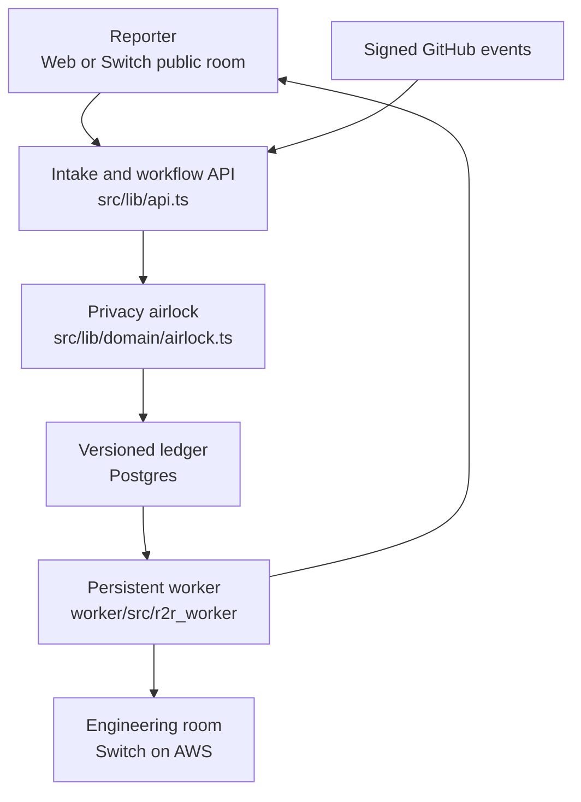

# Reporter-to-Release

**Team Vulcan**

- Aditya Arnav (@hydra_of_malice), leader
- Pallab Das (@pdgamersg)
- Yuvraj Singh (@yuvraj25)
- Sri Ram (@sriramdevs)

Deployment is in progress. The intended web address is `reporter-to-release.pallabdas.me`; Switch and its persistent worker run on AWS.

Reporter-to-Release follows a bug from an outside reporter through a sanitized dossier, duplicate grouping, a failing reproduction, reporter confirmation, human review, a production deployment and a final confirmation from the reporter. Built for the Flip the Switch hackathon, Track 1: Business Workflow.

The application separates public intake from privileged engineering work. A deterministic airlock discards instruction-bearing reports and redacts common personal data. Fixes cannot begin before reporter confirmation; agents cannot record a human approval or merge.

## Features

| Feature | What it does |
| --- | --- |
| Intake airlock | Normalizes text, redacts personal data and quarantines instruction signals |
| Duplicate clusters | Groups similar reports while retaining each reporter's delivery route |
| Reproduction gate | Records a failing test before the original reporter can unlock a fix |
| Human review | Requires a human approval; sensitive paths require two people including a code owner |
| Release relay | Verifies GitHub webhook signatures and production commit ancestry |
| Reliable notifications | Uses leased outbox jobs with acknowledgements and retry delays |
| Isolated demo | Gives each visitor a separate example workspace, apart from live reports |

## How it works

The web API owns state; the persistent Switch worker routes sanitized documents and reporter confirmation cards.



Only structured, sanitized facts reach engineering. GitHub merge events record a human merge; successful production deployment events queue a notice for every reporter. Reporter rejection reopens the workflow.

## Tech stack

| Component | Purpose | License |
| --- | --- | --- |
| Next.js and React | Same-origin web application and HTTP API | MIT |
| TypeScript and Zod | Domain contracts and input validation | Apache-2.0 / MIT |
| Neon Postgres | Durable ledger with optimistic concurrency | PostgreSQL service |
| Python and httpx | Persistent Switch adapter | PSF / BSD-3-Clause |
| Switch | Agent rooms and native approval cards | Apache-2.0 with Commons Clause |
| Vitest, pytest, Playwright | Domain, integration and browser checks | MIT / MIT / Apache-2.0 |

## Quick start

Prerequisites: Node.js 22 or newer, Python 3.12 or newer, and uv for the worker.

```bash
git clone https://github.com/PDGamerSG/Reporter-to-Release.git
cd Reporter-to-Release
npm ci
cp .env.example .env.local
npm run dev
```

With no `DATABASE_URL`, local development uses `.data/` files. Vercel deployments require Postgres. Generate unique values for `SESSION_SECRET`, `ADMIN_TOKEN`, `WORKER_TOKEN` and `GITHUB_WEBHOOK_SECRET`; keep `.env.local` private.

### Checks

```bash
npm run check
npm run build
uv sync --project worker --extra test
uv run --project worker pytest -c worker/pyproject.toml worker/tests -q
uv run --project worker ruff check worker/src/r2r_worker worker/tests
```

### Deploy

Provision Postgres, set the environment variables, run `npm run db:init`, and deploy the web app on Vercel. Run the Switch stack and `r2r-worker` on an AWS EC2 host. Configure the GitHub repository webhook for `/api/webhooks/github` with the same signing secret. Install the desk and fix-room templates in Switch Console.

## Repository map

| Path | What it holds |
| --- | --- |
| `src/lib/domain/` | Sanitization, workflow guards, audit events and notification jobs |
| `src/lib/store/` | Postgres and local persistence adapters |
| `src/app/api/` | Same-origin API entry point |
| `worker/` | Always-on Switch connections and delivery adapter |
| `templates/` | Switch Console desk and per-bug fix-room templates |
| `migrations/` | Postgres schema |
| `tests/` | Workflow, security, concurrency and API tests |
| `docs/BUILD_PLAN.md` | Build scope and acceptance conditions |

## Documentation

- [Build plan](docs/BUILD_PLAN.md)
- Original concept: [reporter-to-release](https://github.com/Hydra-Of-Malice/reporter-to-release)
- Protocol research and generic Switch client: [switch-hackathon-research](https://github.com/Hydra-Of-Malice/switch-hackathon-research)

## Known limits

- Telegram and Slack need the team's bot/workspace credentials. A deployed server alone does not connect these accounts.
- Vendor agents require their own authenticated Switch Console providers. Demo transitions do not execute real vendor agents or change GitHub pull requests.
- The text airlock is deterministic defense in depth, not a complete prompt-injection or personal-data detector. Quarantined raw text is discarded.
- The versioned JSON ledger is intended for this hackathon's volume. High-volume deployments should move individual entities to relational tables.
- Screenshots, deployment verification and the browser acceptance suite are being completed before release.

## License

No project-wide license has been selected. Third-party components retain their own licenses. The generic Switch protocol client is reused from the team's research repository; the application workflow is implemented in this repository during the hackathon.
