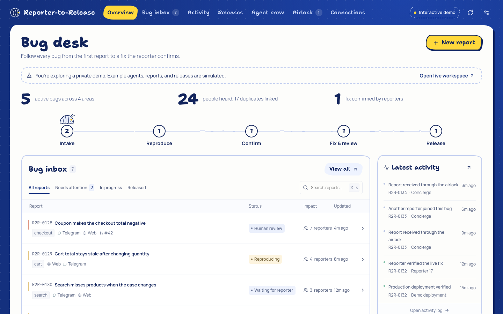
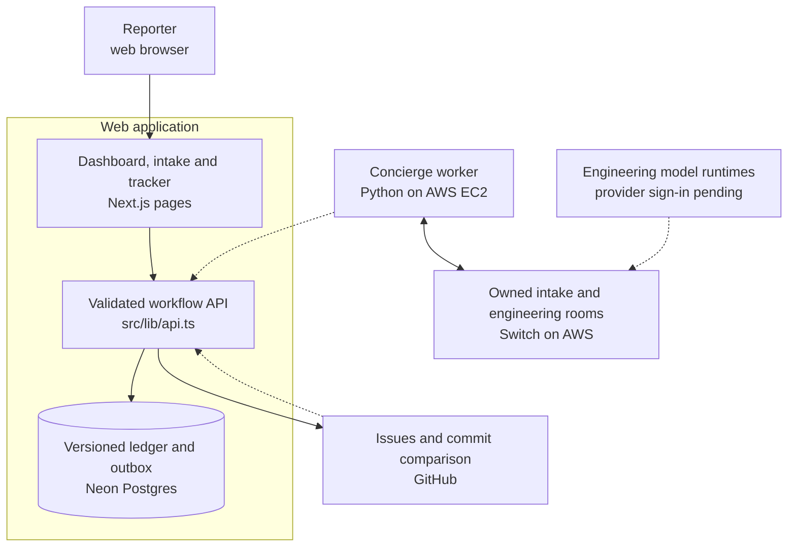
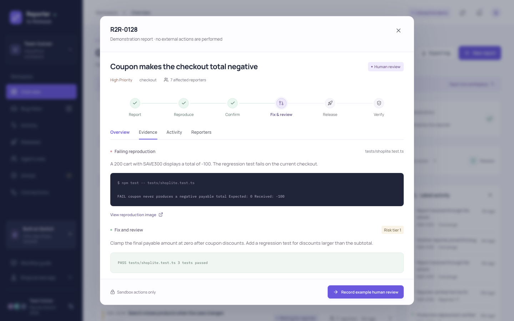
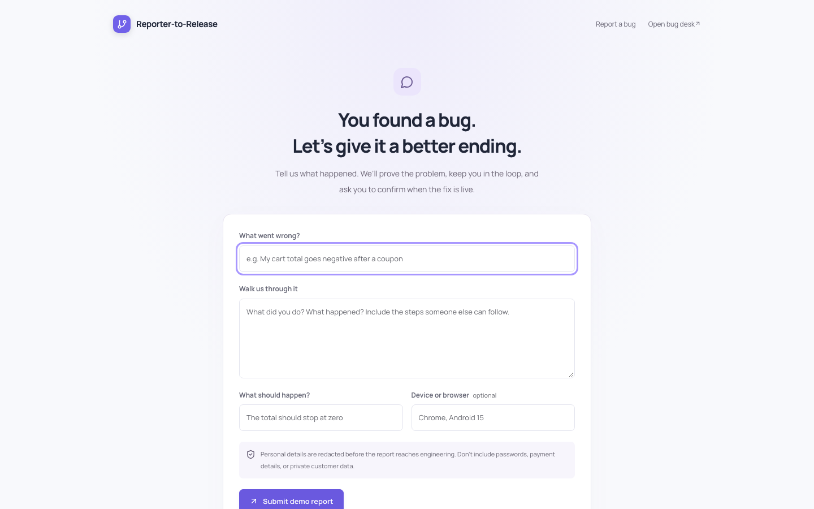
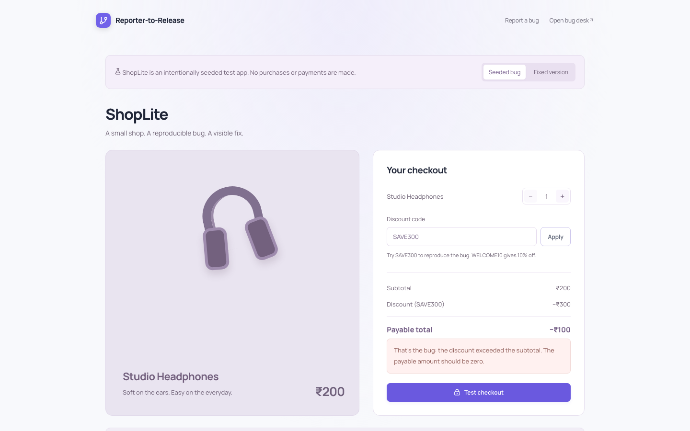

# Reporter-to-Release

**Team Vulcan**

- Aditya Arnav (@hydra_of_malice), leader
- Pallab Das (@pdgamersg)
- Yuvraj Singh (@yuvraj25)
- Sri Ram (@sriramdevs)

Live link: [reporter-to-release.pallabdas.me](https://reporter-to-release.pallabdas.me/)

<p align="center">
  
</p>

Reporter-to-Release gives people a way to report a bug and stay involved until its fix works for them. The desk groups duplicate reports, records a failing reproduction, asks the reporter to confirm it, and requires human review before a production release can close the loop. If a reporter still sees the failure, the bug reopens.

This repository contains the web app, guarded workflow API, durable ledger, Switch worker, deployment scripts, tests, and documentation. Web intake, AI triage, and the AWS Switch handoff are live. Telegram and Slack are deferred. The home page is one small screen: a person describes a bug and reads the AI triage beside it. The operator workspace at `/desk` opens an isolated demo with clearly labeled simulated progress.

Built for Flip the Switch, November 4–7, 2026. This repository's implementation began November 7. The concept and generic Switch client come from earlier research; [the contribution record](docs/EVENT_CONTRIBUTION.md) identifies that baseline and the new work without counting earlier benchmarks as event validation.

## Features

| Feature                | What it does                                                                                                                  |
| ---------------------- | ----------------------------------------------------------------------------------------------------------------------------- |
| Web bug reports        | Accepts observed behavior and gives each reporter a private tracking link.                                                    |
| AI triage              | Returns an advisory summary, severity, likely cause, reproduction steps, and regression test idea from a server-side proxy.   |
| Privacy airlock        | Redacts known personal-data and secret patterns, discards raw input, and holds detected instructions for human review.        |
| Duplicate clusters     | Links similar reports so affected people share evidence and release updates.                                                  |
| Proof before fixing    | Requires reproduction evidence and original-reporter confirmation before a fix can start.                                     |
| Human review           | Checks the reviewed PR head; sensitive paths require two verified GitHub humans, including a code owner.                      |
| Release confirmation   | Uses signed production deployment evidence and commit ancestry, then accepts reporter confirmation or reopening.              |
| Durable delivery       | Persists workflow state and retryable jobs in Postgres; the AWS worker relays sanitized dossiers through owned Switch rooms.  |
| Isolated demonstration | Lets visitors explore the lifecycle and reproduce ShopLite's actual coupon calculation defect without changing the live desk. |

## How it works

A web report becomes a sanitized dossier in the ledger; the Switch worker hands it to engineering while the reporter keeps a private view of its progress.



The API checks authority and lifecycle prerequisites on every write. The worker claims delivery jobs, creates a sanitized issue/dossier, and records acknowledgements. Signed GitHub reviews, merges, and production deployments supply release evidence; early deployment events are retained for later reconciliation. Engineering runtimes are not active yet. [Architecture notes](docs/ARCHITECTURE.md) describe the boundaries, request flow, and data model.

## Screenshots

Captured from the live custom domain on November 7, 2026 in Chromium at 1440 × 900, light theme, with reduced motion. Dashboard and dossier images show the labeled demo; the report form is in demo mode. ShopLite is the seeded test app.

<p align="center">
  
  <br><em>Evidence stays attached to the bug as it moves through the workflow.</em>
</p>

<table>
  <tr>
    <td width="50%"></td>
    <td width="50%"></td>
  </tr>
  <tr>
    <td><em>A web report starts the loop.</em></td>
    <td><em>A seeded defect that an executable assertion can reproduce.</em></td>
  </tr>
</table>

## Tech stack

| Component                         | Purpose                                                   | License                                 |
| --------------------------------- | --------------------------------------------------------- | --------------------------------------- |
| Next.js 16 / React 19             | Web interface and same-origin API                         | MIT                                     |
| TypeScript / Zod                  | Domain types and request validation                       | Apache-2.0 / MIT                        |
| Neon Postgres / Neon driver       | Durable versioned ledger                                  | PostgreSQL License / MIT                |
| Python / HTTPX / websockets       | Persistent Switch worker                                  | PSF / BSD-3-Clause / BSD-3-Clause       |
| Switch                            | Agent identities, rooms, addressing, and dossier handoffs | Apache-2.0 with modified Commons Clause |
| Lucide / Manrope / IBM Plex Mono  | Icons and interface typography                            | ISC / OFL-1.1 / OFL-1.1                 |
| Vitest / Playwright / axe adapter | Domain, integration, browser, and accessibility checks    | MIT / Apache-2.0 / MPL-2.0              |
| Vercel / AWS / Namecheap          | Application hosting, worker hosting, and DNS              | Hosted services                         |

The imported generic `switchkit` client has no recorded license grant in its source repository. See [third-party notices](THIRD_PARTY_NOTICES.md) for versions, attribution, and the full Switch license.

## Quick start

Use Node.js 22 or newer and npm. Python 3.12+ and uv are needed only for worker development. Local web development requires no cloud account or chat tokens.

```bash
git clone https://github.com/PDGamerSG/Reporter-to-Release.git
cd Reporter-to-Release
npm ci
npm run setup
npm run dev
# Open http://127.0.0.1:3000
```

Setup generates private secrets in `.env.local` and preserves an existing configuration. With no `DATABASE_URL`, a local file ledger supports one Node process. Production requires Postgres. Read [configuration](docs/CONFIGURATION.md) before enabling external services; see [troubleshooting](docs/TROUBLESHOOTING.md) if a step fails.

### Checks

```bash
npm run format:check
npm run check
npm audit --audit-level=moderate
npm run build
uv sync --project worker --extra test --frozen
uv run --project worker pytest -c worker/pyproject.toml worker/tests -q
uv run --project worker ruff check worker/src/r2r_worker worker/tests
```

For the 16 browser scenarios, install Chromium, start the built app on port 3107 in another terminal, and run Playwright:

```bash
npx playwright install chromium
npm run start -- --port 3107
# In another terminal:
npm run test:e2e
```

The verified implementation passes 64 TypeScript tests, 7 worker tests, and 16 browser scenarios. [CI](.github/workflows/ci.yml) runs checks, audit, build, and browser acceptance on main pushes and PRs using isolated configuration. The [test plan](docs/testing/test-plan.md) separates live acceptance evidence from simulations.

To run the seeded failing-to-passing example:

```bash
npm run demo:reproduce
# Intentionally exits 1: -100 is not 0.
npm run demo:reproduce -- --fixed
# Exits 0: the payable amount is clamped to zero.
```

### Deploy

The live app runs on Vercel with Neon Postgres. The Switch server and persistent Python worker run on AWS EC2 in `ap-southeast-2`, behind Caddy HTTPS. Namecheap connects the custom hostnames. Main is connected to Vercel's production deployment integration.

Configure production secrets, initialize the ledger with `npm run db:init`, deploy the intended revision, and verify HTTPS plus the immutable release's assets. Use [deployment and operations](docs/operations/deployment.md) for the checked-in host setup, SSM worker deployment, GitHub webhook, recovery, and shutdown steps. AWS resources incur charges while retained.

## Repository map

| Path                                | What it holds                                                                         |
| ----------------------------------- | ------------------------------------------------------------------------------------- |
| `src/app/`                          | One-page reporter home, `/desk`, tracking page, ShopLite, and API route.              |
| `src/components/`                   | Reporter page, operator workspace, tracker, dialogs, and lifecycle UI.                |
| `src/lib/domain/`                   | Airlock, clustering, guarded transitions, audit events, and outbox.                   |
| `src/lib/ai/`                       | Server-side model proxy, cached prompt prefix, and spending guard.                    |
| `src/lib/store/`                    | Memory, local file, and Postgres compare-and-swap stores.                             |
| `src/lib/integrations/`             | Signed GitHub review, merge, and deployment relay.                                    |
| `worker/src/r2r_worker/`            | Project-specific Switch adapter and native identity boundary.                         |
| `worker/src/switchkit/`             | Attributed generic protocol client from earlier research.                             |
| `templates/`                        | Desk and per-bug fix-room templates for later provider setup.                         |
| `scripts/`, `infra/`, `migrations/` | Local setup, executable regression, AWS deployment, container configuration, and SQL. |
| `tests/`, `e2e/`, `worker/tests/`   | Application, browser, and worker checks.                                              |
| `docs/`, `.github/`                 | Documentation, captured screenshots, code owners, and CI.                             |

## Documentation

- [Documentation index](docs/README.md): all project guides.
- [User guide](docs/user-guide.md): report, track, explore, and operate the desk.
- [Architecture](docs/ARCHITECTURE.md): components, lifecycle, boundaries, and persistence.
- [Configuration](docs/CONFIGURATION.md): environment variables and credentials.
- [API](docs/api/README.md): public, owner, worker, and signed webhook endpoints.
- [Deployment and operations](docs/operations/deployment.md): AWS, Vercel, DNS, recovery, and shutdown.
- [Threat model](docs/security/threat-model.md): controls and trust assumptions.
- [Test plan](docs/testing/test-plan.md): checks, CI, and evidence limits.
- [Design](docs/DESIGN.md): interface tokens, responsiveness, and accessibility.
- [Troubleshooting](docs/TROUBLESHOOTING.md): common setup and delivery failures.
- [Event contribution](docs/EVENT_CONTRIBUTION.md): earlier research, new work, and actual timestamps.

## Known limits

- Engineering model runtimes need provider sign-in. The registered manager destination does not run a model by itself; no live autonomous fix PR is claimed.
- Telegram and Slack are deferred. Web reporters read updates on their private tracking page; email and push notifications are not implemented.
- AI triage is advisory. It never changes severity or workflow state, and it reads only the sanitized dossier, so it cannot see redacted details or the codebase. Its likely cause is an unverified hypothesis.
- The app's spending cap counts this app's calls only. It cannot read the provider's credit balance, so check that in the Model API dashboard.
- Redaction and instruction detection are heuristic. Voice reports and screenshot uploads are not supported by the web form.
- Authorized engineering actors supply test output and changed paths. The ledger does not execute those tests or independently verify that evidence.
- Owner access uses a shared key. Sensitive approval gates require verified GitHub identities; a second authorized human must be configured for those fixes.
- The complete release/reopen sequence is proven in isolated tests and the labeled demo. Live acceptance proves intake, tracking, issue creation, Switch delivery, and webhook connectivity.
- Vercel builds main automatically; verified production releases must also be recorded in GitHub Deployments for the signed release relay. [Operations](docs/operations/deployment.md) describes that step.
- One JSON ledger per workspace and one AWS host limit scale and availability. Delivery can repeat across a crash at an external-send boundary; backup/restore operations remain the owner's responsibility.

## License

No project license has been selected. No root `LICENSE` file grants reuse rights for the original project code. Dependencies and imported components retain their own terms; see [third-party notices](THIRD_PARTY_NOTICES.md) and [the full Switch license](docs/licenses/SWITCH-LICENSE.txt).
