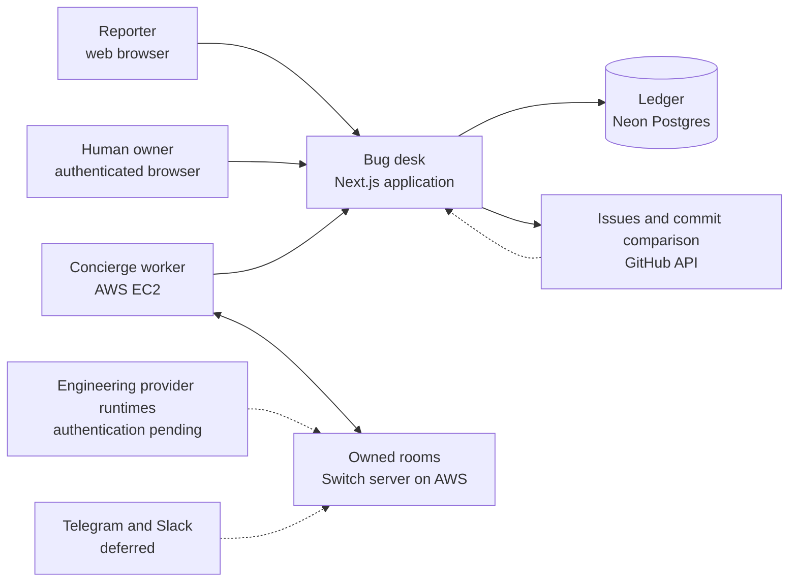
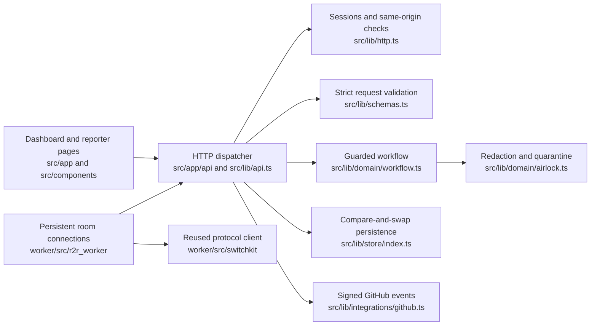
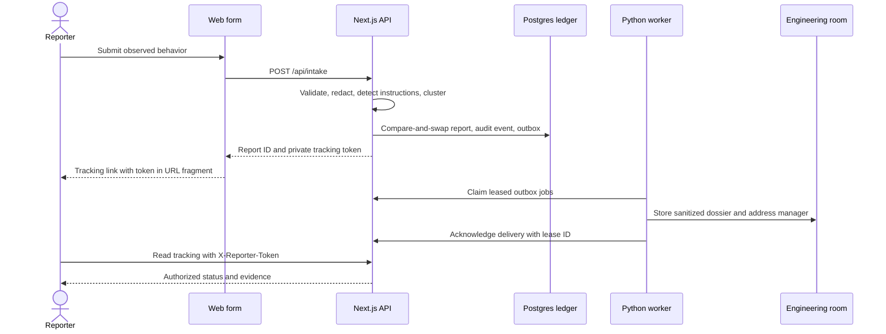
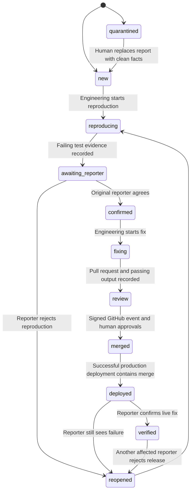
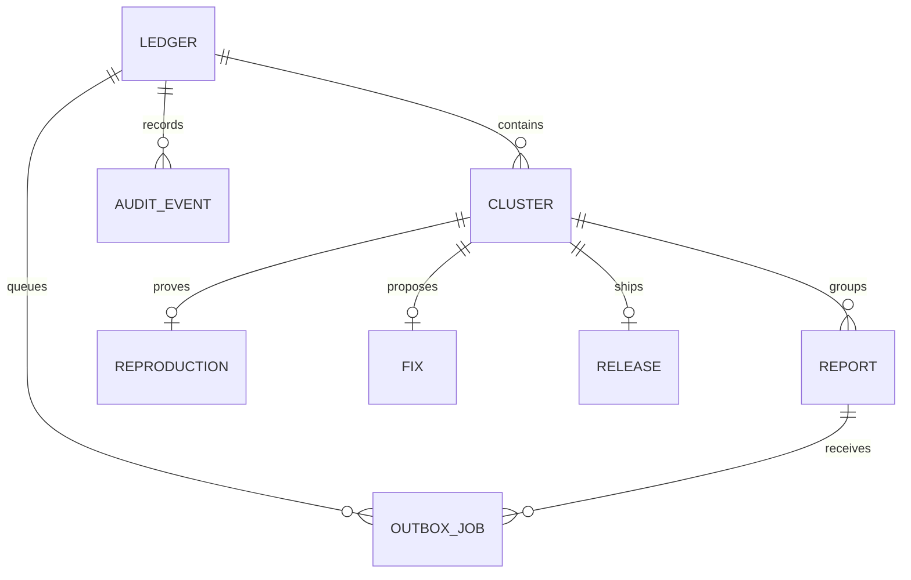
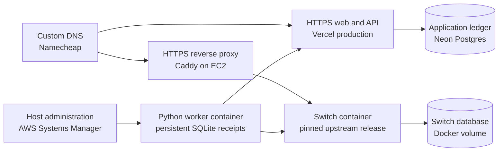

# Architecture

The Next.js application owns the workflow and its durable state. A Python worker connects two owned Switch rooms and delivers the application's outbox. GitHub supplies signed review, merge, and deployment evidence. Public reporters use the web form and a private capability link.

## System context

Sources: [API](../src/lib/api.ts), [worker](../worker/src/r2r_worker/main.py), [GitHub relay](../src/lib/integrations/github.ts), [worker compose](../infra/worker.compose.yml). Dashed runtime and chat connections are not active. A registered manager destination does not mean an engineering model is running.

## Components

Sources: the paths in the node labels. The [provenance record](EVENT_CONTRIBUTION.md) identifies the imported client and its event-period modification.

## Intake sequence

Sources: [ReportForm](../src/components/report-form.tsx), [API](../src/lib/api.ts), [airlock](../src/lib/domain/airlock.ts), [outbox](../src/lib/domain/outbox.ts), [worker](../worker/src/r2r_worker/main.py). Quarantined input produces no engineering dossier job. Web updates are read on the private tracking page; there is no email or browser push delivery.

## Lifecycle and authority

Source: [workflow](../src/lib/domain/workflow.ts). At least one affected reporter must confirm the reproduction before fixing. A release remains rejectable by another member of the cluster after the first reporter verifies it. Sensitive paths require two distinct human approvals, including a configured code owner. The production owner configuration currently lists one human, so a second verified human must be added before a sensitive fix can pass that gate.

The ledger validates who supplied evidence and the allowed transition. Sensitive approvals count distinct human identities verified by signed GitHub reviews; the shared owner web key cannot satisfy that gate. The ledger does not execute submitted shell commands or prove that pasted test output is authentic. Humans and configured engineering runtimes are responsible for running and reviewing the tests. The isolated demo uses explicit simulation controls and cannot record a real merge or deployment.

## Data model

One physical table, `r2r_ledgers`, stores each workspace as a versioned JSON document. A live workspace uses the key `live`; each demo uses a separate signed-session-derived key. The following entities are logical objects inside that document, not separate SQL tables.

Sources: [types](../src/lib/domain/types.ts), [migration](../migrations/001_ledger.sql), [store](../src/lib/store/index.ts). `version` supports compare-and-swap; mutations retry after contention. Raw report bodies are discarded after redaction and hashing. Private tracking tokens are stored only as hashes. Audit entries are append-only through application operations; the database administrator can still alter stored documents.

Successful production deployments remain in an optional ledger history so a later-arriving merge can reconcile them. Ancestry checks use the current mutation snapshot and are recalculated after compare-and-swap contention. Reporter tracking uses an allowlisted projection of safe observations, reproduction summary/steps, and release information; internal commands, review notes, test paths, and private screenshots are excluded.

Outbox claims use leases, attempt counters, due times, and acknowledgement IDs. Failed deliveries retry with bounded exponential delay. The worker stores delivery receipts in a persistent SQLite file and reuses existing dossier documents after a restart. External chat sends can still repeat if the process dies between sending and persisting its receipt; this is at-least-once delivery, not a universal exactly-once guarantee.

## Deployment

Sources: [host setup](../scripts/setup-switch-host.sh), [worker deployment](../scripts/deploy-worker.py), [Caddyfile](../infra/Caddyfile), [worker compose](../infra/worker.compose.yml). EC2 accepts public ports 80 and 443. The Switch and database ports bind to loopback. There is no SSH ingress. The EC2 instance is a single host; it is not a highly available cluster.
